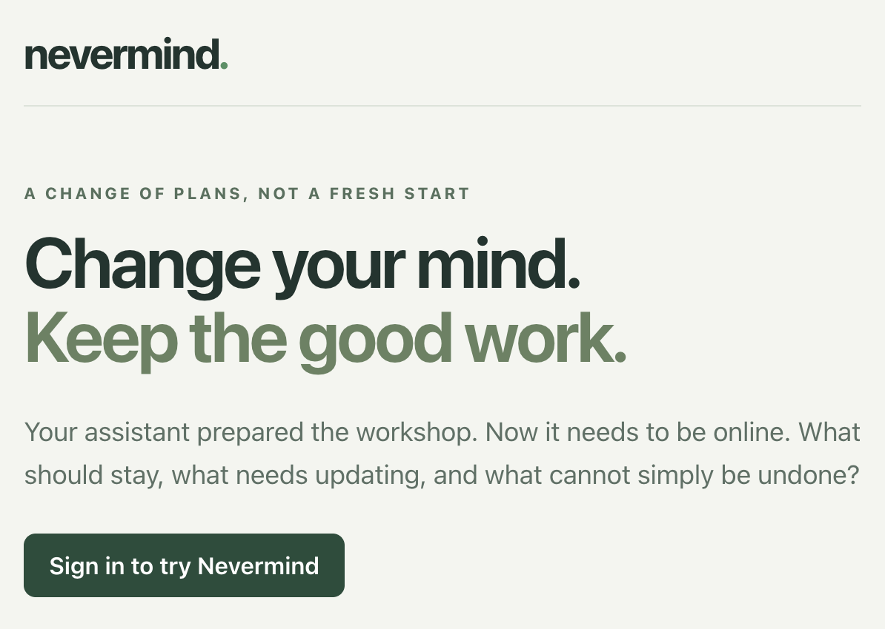

# Nevermind

Change your plans without throwing away good work.

Nevermind is an experimental workshop assistant, started for the AWS Agent Experience Hackathon. It reviews what is still valid when a user changes the goal, prepares exact updates, and waits for approval. A separate approval is required to request cancellation of an already-sent catering message.

**Real model calls, simulated effects.** The six prepared resources are synthetic fixtures. Room holds, drafts, and sent messages live in the sandbox database; there are no external booking or email integrations.



## The demonstration

1. Load the prepared in-person Python workshop.
2. Request: **"Make it online. Same date and time."**
3. Review proposed updates. Slides and the unrelated sponsor note should remain unchanged.
4. Approve the exact preview. The application checks the current resource versions before writing.
5. Separately approve the proposed catering cancellation. The original sent request remains in history; vendor acceptance is not claimed.

Also try **"What if we made it online?"** and **"Make it online, but keep the room for local attendees."** Hypotheticals cannot be applied. Uncertain model decisions require clarification instead of silently authorizing a change.

See the [recording guide](docs/demo.md) for a short demonstration sequence and safe screenshot capture. A public video has not been recorded yet.

## Status

Verified on AWS with real Nova and Decider calls, using an isolated synthetic workspace:

- An uncertain review blocked approval and left the workspace unchanged.
- "Make it online. Same date and time." produced a ready review. After approval, the room, invitation, and handouts moved to version 2; slides and the sponsor note stayed unchanged; the sent catering message remained with no cancellation requested.
- Separate cancellation approval appended one message and preserved the original. Repeating either standard approval or cancellation had no duplicate effect.
- A hypothetical review could not be applied. Wrong preview hashes, premature cancellation, and a preview invalidated by resetting the workspace were rejected without changing the workspace or history.
- These acceptance checks used the actual Cognito hosted authorization-code flow with PKCE and the public JWT-protected API, not an administrator-invoked Lambda event. They are API-level checks, not a claim that every browser interaction has been verified.

Model confidence remains input-sensitive. The first keep-room review preserved the room and catering but blocked approval on uncertainty about the invitation and materials. The requirement description was clarified to distinguish optional local attendance from required travel and to state that remote attendees receive digital materials. The threshold was not lowered.

- With the clarified input, the keep-room review and approval passed on the infrastructure-managed runtime: invitation and handouts updated; room, catering, slides, and sponsor remained unchanged.
- The new runtime was built and deployed from the checked-in templates and scripts. Real inference and a repeat deployment were verified before connecting the application.

These are small acceptance checks, not an accuracy benchmark. The confidence threshold has not been calibrated on a representative dataset.

## Model responsibilities

- **Amazon Nova 2 Lite on Bedrock** proposes structured goal changes with quotes from the request and drafts replacement content. One validation correction is allowed; invalid output or model failures are explicit errors.
- **Strands Decider 2B** classifies request intent and whether affected assumptions are supported, contradicted, or unresolved.
- **Application code** owns dependencies, unchanged work, exact-preview approval, resource versions, transactions, and preventing duplicate effects.

The implementation uses a small, bounded Bedrock Converse tool-proposal loop rather than a general-purpose agent framework. The model's tools submit proposals; they cannot directly mutate the database or bypass user approval.

Decider receives readable current requirements. A stored venue is not presented as a current physical-location requirement after an online-only change. The original content remains available in the review; only its relevance to the updated goal changes.

## Architecture

```text
React website -> CloudFront -> API Gateway + Cognito -> Lambda API
                                                       |
                                                       v
                                                      SQS
                                                       |
                                                       v
                                                  Lambda worker
                                                /              \
                                       Bedrock Nova       AgentCore Decider
                                                \              /
                                              DynamoDB previews

Approved preview -> Lambda API -> transactional workspace + action history
```

The API returns an analysis ID promptly, and the browser polls for status. Model startup and review can take longer than an ordinary HTTP request. The website can remain available while there are no active model sessions.

Each Cognito user has a separate sandbox. Public registration is disabled. The API validates access tokens through API Gateway and derives ownership from the verified identity, not a user ID supplied in the request. Up to 20 analyses per user per UTC day are allowed, with one active analysis per sandbox.

## Setup and checks

Requirements: Python 3.12, Node.js 22.12+ or a compatible newer version, npm, and AWS CLI v2.

```bash
python3.12 -m venv .venv
.venv/bin/pip install --require-hashes -r requirements-dev.lock
.venv/bin/pip install --no-deps -e .

.venv/bin/ruff check backend tests deploy examples
.venv/bin/ruff format --check backend tests deploy examples
.venv/bin/mypy backend deploy/runtime_source.py
.venv/bin/pytest -q
.venv/bin/cfn-lint --regions us-east-1 --template deploy/app.yaml deploy/runtime-build.yaml deploy/runtime.yaml
for script in deploy/*.sh; do bash -n "$script"; done

cd frontend
npm ci
npm run lint
npm run build
```

Tests use Moto and synthetic model responses to check execution rules; these tests do not establish real-model accuracy. Real-model checks must be reported separately.

## Deploy

Use a project-specific AWS profile locally. Never place access keys in the repository or browser. Lambda uses execution roles.

The application template expects an existing IAM-authenticated Decider AgentCore runtime with the HTTP protocol. [This upstream hosting example](https://github.com/Vivek0712/strands-decider-agentcore) demonstrates the model-compression approach. The test image in [deploy/Dockerfile.decider-test](deploy/Dockerfile.decider-test) pins its sources, preserves the upstream license, and enables strict context-window rejection. It is not a general production model server.

The image also uses [runtime_downloads.py](deploy/runtime_downloads.py) for at most three attempts on transient download transport failures or selected retryable HTTP statuses. Invalid model names and authorization failures are not retried. Exhausted attempts remain visible failures; no model decision is replaced or fabricated.

### Decider runtime setup

Install [CloudFormation Guard](https://github.com/aws-cloudformation/cloudformation-guard) and make `cfn-guard` available on `PATH`. The following command provisions billable AWS resources; use it only in an approved account. The demonstrated region is `us-east-1`.

```bash
export AWS_PROFILE=your-project-profile
export AWS_REGION=us-east-1

bash deploy/runtime.sh
```

The script deploys two separate CloudFormation stacks:

- [runtime-build.yaml](deploy/runtime-build.yaml): private versioned source bucket, private immutable ECR repository, encrypted three-day logs, and a bounded ARM64 CodeBuild project. Docker and model weights are not installed locally.
- [runtime.yaml](deploy/runtime.yaml): scoped execution role, HTTP AgentCore runtime, encrypted three-day logs, and a `probe` endpoint pointing to the deployed version. Inbound requests use IAM authentication; unsigned inference is rejected. `PUBLIC` is the development runtime's networking mode, not permission for anonymous inference.

Only the Dockerfile, download helper, and build specification enter the source archive. Its content hash identifies an immutable image tag; repeat deployment reuses an existing image. Images are deployed by digest. The script prints change sets and refuses resource deletions or replacements; inspect those manually instead. Build time, network retries, and session lifetime are bounded.

Defaults are `NEVERMIND_RUNTIME_STACK=nevermind-model` and `NEVERMIND_RUNTIME_NAME=nevermind_decider`. Set both to unique names for a separate environment. Outputs and build records go to ignored `.local/runtime/`. Do not reuse the script to adopt a runtime created outside its stacks.

The pinned model revision, int8 compression, strict 2,048-token context window, 60-second idle timeout, and 1,800-second maximum session lifetime are explicit in the template. Do not silently relax these settings to conceal model failures.

An actual ARM64 build, runtime creation, signed inference, unsigned-request rejection, and no-change repeat deployment were tested. This is reproducible demonstration infrastructure, not a fully locked or production-hardened model supply chain: the base image tag and some upstream transitive dependencies can still change across fresh builds.

Read the runtime ARN from the script's output and check inference before connecting the app:

```bash
export NEVERMIND_RUNTIME_ARN=your-agentcore-runtime-arn
AWS_DEFAULT_REGION=us-east-1 .venv/bin/python examples/check_change.py \
  --runtime-arn "$NEVERMIND_RUNTIME_ARN"
```

### Application deployment

```bash
export AWS_PROFILE=your-project-profile
export AWS_REGION=us-east-1
export NEVERMIND_RUNTIME_ARN=your-agentcore-runtime-arn

bash deploy/package.sh
bash deploy/deploy.sh
```

The deployment creates an invite-only Cognito login, private website bucket, CloudFront distribution, JWT-protected API, two Lambda functions, a job queue and failure queue, encrypted logs, and a DynamoDB table. It does not create public registration or anonymous model access.

CloudFormation change-set validation and local schema validation run before execution. [deploy/security.guard](deploy/security.guard) provides additional CloudFormation Guard rules. Install the official Guard tool separately to run them:

```bash
cfn-guard validate --rules deploy/security.guard --data deploy/app.yaml --output-format json
```

Create invited users through Cognito administration. Use an independently chosen password or a locally generated one; do not include credentials in source, screenshots, logs, or the demo video. The browser uses Cognito's hosted authorization-code flow with PKCE and keeps access tokens in memory, not localStorage.

```bash
AWS_PROFILE=your-project-profile AWS_DEFAULT_REGION=us-east-1 \
  .venv/bin/python deploy/create_invite.py owner --generate
```

The generated password is saved only in `.local/deploy/login-owner.json`, with owner-only file permissions. Omit `--generate` to enter a password interactively instead. This command refuses to overwrite an existing local credential file.

Runtime deployment output and frontend configuration are written under ignored `.local/deploy/`. `clientId` and login URLs are public configuration, not credentials.

## Reusable decision pattern: `semantic_change_impact`

The reusable part is a short assumption-relation question, its typed choices, and the policy deciding what happens next:

| Choice | Application behavior |
|---|---|
| `supported` | Preserve the item if the evidence and dependencies remain valid. |
| `contradicted` | Propose a draft update, room change, or separately approved cancellation according to known tool capabilities. |
| `unresolved` or low confidence | Ask for clarification; do not execute. |

The question is exported as `RELATION_QUESTION` in [clients.py](backend/nevermind/clients.py). [planner.py](backend/nevermind/planner.py) puts it in the application's path, only for resources whose inputs changed. [policy.py](backend/nevermind/policy.py) maps decisions into proposals and validates approvals independently of the models.

The example runs without the website or database:

```bash
.venv/bin/python examples/check_change.py --preview
AWS_PROFILE=your-project-profile AWS_DEFAULT_REGION=us-east-1 \
  .venv/bin/python examples/check_change.py --runtime-arn your-runtime-arn
```

The preview command makes no model call and prints no pretend decision. Real inference requires access to the specified runtime.

The confidence threshold of 0.70 is a conservative initial setting, **not a calibrated safety guarantee**. Evaluate it on fresh labeled cases before relying on it in another application.

## Data, failures, and limits

- Workspace schema version 1 is explicit. Unsupported future versions fail validation instead of being silently reinterpreted.
- Approvals are bound to a stored preview hash, workspace revision, and individual resource versions.
- Standard updates and their history event commit together. Cancellation is a separate transaction that appends a message.
- Repeated apply requests return the already-persisted outcome without repeating effects.
- A reset invalidates old previews. Hypothetical previews are never executable.
- Runs expire after seven days. DynamoDB point-in-time recovery is enabled; workspace and history storage are retained when the stack is removed.
- Model errors remain visible. No keyword heuristic or canned response is substituted for failed inference.
- Generated content is rendered as text, not HTML.
- CPU inference is not subsecond: initial feasibility measurements were roughly 43-62 seconds on first use, around seven seconds for individual warm checks, and 30-33 seconds for six related checks. These are small experiments on one deployment, not service guarantees.
- Compression may affect probabilities and choices. Broader-context tests showed errors even when narrow checks were correct. Do not describe this prototype as production-ready.
- The original sent fixture message remains. A cancellation request does not establish real-world cancellation.

## Costs and cleanup

There is no always-running EC2 or SageMaker host in this architecture. AgentCore sessions, Bedrock tokens, Lambda, queues, API requests, database usage, storage, logs, and KMS can still incur charges. The configured limits are safeguards, not a hard billing cap.

Worker sessions are stopped after analysis, with a runtime idle timeout as a backup. Keep website assets available for the demo, but do not retain active model sessions just to keep the page online.

Before deleting infrastructure, export any results you need and inspect retained resources. DynamoDB, Cognito users, the website bucket, the log key, the artifact bucket, and the separately deployed AgentCore resources may remain and incur charges. Delete them only after explicitly deciding that their data is no longer needed.

For the managed runtime deployment, delete the runtime stack before the build stack, and retain the log key while encrypted logs exist. The build bucket, image repository, and log key deliberately survive stack deletion. Inspect and remove retained objects, versions, images, and keys separately only after approving their disposal. Account-wide bills can contain unrelated projects; do not treat all resources as Nevermind cleanup targets.

## License

[MIT](LICENSE). The Decider test image clones and builds third-party code under its own license, which the image preserves.
