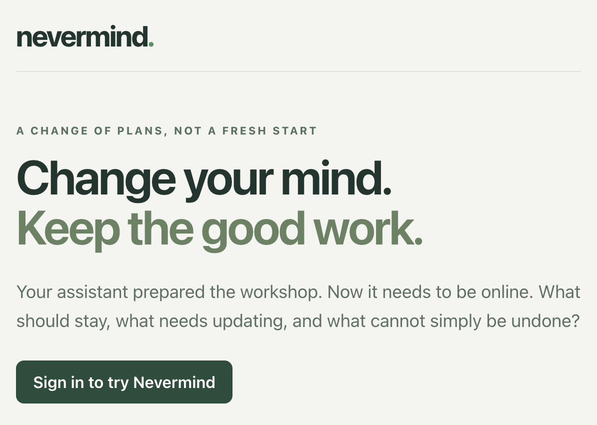

# Nevermind

Change your plans without throwing away good work.

Nevermind is an experimental workshop assistant, started for the AWS Agent Experience Hackathon. It reviews what is still valid when a user changes the goal, prepares exact updates, and waits for approval. A separate approval is required to request cancellation of an already-sent catering message.

**Real model calls, simulated effects.** The six prepared resources are synthetic fixtures. Room holds, drafts, and sent messages live in the sandbox database; there are no external booking or email integrations.



## The demonstration

1. Load the prepared in-person Python workshop.
2. Request: **"Make it online. Same date and time."**
3. Review proposed updates. Slides and the unrelated sponsor note should remain unchanged.
4. Approve the exact preview. The application checks the current resource versions before writing.
5. Separately approve the proposed catering cancellation. The original sent request remains in history; vendor acceptance is not claimed.

Also try **"What if we made it online?"** and **"Make it online, but keep the room for local attendees."** Hypotheticals cannot be applied. Uncertain model decisions require clarification instead of silently authorizing a change.

See the [recording guide](docs/demo.md) for a short demonstration sequence and safe screenshot capture. A public video has not been recorded yet.

## Status

Verified on AWS with real Nova and Decider calls, using an isolated synthetic workspace:

- An uncertain review blocked approval and left the workspace unchanged.
- "Make it online. Same date and time." produced a ready review. After approval, the room, invitation, and handouts moved to version 2; slides and the sponsor note stayed unchanged; the sent catering message remained with no cancellation requested.
- Separate cancellation approval appended one message and preserved the original. Repeating either standard approval or cancellation had no duplicate effect.
- A hypothetical review could not be applied. Wrong preview hashes, premature cancellation, and a preview invalidated by resetting the workspace were rejected without changing the workspace or history.
- These acceptance checks used the actual Cognito hosted authorization-code flow with PKCE and the public JWT-protected API, not an administrator-invoked Lambda event. They are API-level checks, not a claim that every browser interaction has been verified.

Model confidence remains input-sensitive. The first keep-room review preserved the room and catering but blocked approval on uncertainty about the invitation and materials. The requirement description was clarified to distinguish optional local attendance from required travel and to state that remote attendees receive digital materials. The threshold was not lowered.

- With the clarified input, the keep-room review and approval passed on the infrastructure-managed runtime: invitation and handouts updated; room, catering, slides, and sponsor remained unchanged.
- The deployment is defined in Python CDK. A fresh deployment with plain `cdk deploy` (model image built in CodeBuild during deployment, no customer-managed keys) passed signed Decider inference and a full authenticated review; CDK then reported no pending differences.

These are small acceptance checks, not an accuracy benchmark. The confidence threshold has not been calibrated on a representative dataset.

## Model responsibilities

- **Amazon Nova 2 Lite on Bedrock** proposes structured goal changes with quotes from the request and drafts replacement content. One validation correction is allowed; invalid output or model failures are explicit errors.
- **Strands Decider 2B** classifies request intent and whether affected assumptions are supported, contradicted, or unresolved.
- **Application code** owns dependencies, unchanged work, exact-preview approval, resource versions, transactions, and preventing duplicate effects.

The implementation uses a small, bounded Bedrock Converse tool-proposal loop rather than a general-purpose agent framework. The model's tools submit proposals; they cannot directly mutate the database or bypass user approval.

Decider receives readable current requirements. A stored venue is not presented as a current physical-location requirement after an online-only change. The original content remains available in the review; only its relevance to the updated goal changes.

## Architecture

```text
React website -> CloudFront -> API Gateway + Cognito -> Lambda API
                                                       |
                                                       v
                                                      SQS
                                                       |
                                                       v
                                                  Lambda worker
                                                /              \
                                       Bedrock Nova       AgentCore Decider
                                                \              /
                                              DynamoDB previews

Approved preview -> Lambda API -> transactional workspace + action history
```

The API returns an analysis ID promptly, and the browser polls for status. Model startup and review can take longer than an ordinary HTTP request. The website can remain available while there are no active model sessions.

Each Cognito user has a separate sandbox. Public registration is disabled. The API validates access tokens through API Gateway and derives ownership from the verified identity, not a user ID supplied in the request. Up to 20 analyses per user per UTC day are allowed, with one active analysis per sandbox.

## Setup and checks

Requirements: Python 3.12, npm, AWS CLI v2, and Make. Infrastructure tooling installs a pinned workspace-local Node 22 binary.

```bash
python3.12 -m venv .venv
.venv/bin/pip install --require-hashes -r requirements-dev.lock
.venv/bin/pip install --no-deps -e .
make cdk-install

.venv/bin/ruff check backend tests deploy infra examples
.venv/bin/ruff format --check backend tests deploy infra examples
.venv/bin/mypy backend infra
.venv/bin/pytest -q
make cdk-synth
.venv/bin/cfn-lint --regions us-east-1 --template .local/cdk.out/Application.template.json .local/cdk.out/Runtime.template.json
for script in deploy/*.sh; do bash -n "$script"; done

cd frontend
npm ci
npm run lint
npm run build
```

Tests use Moto and synthetic model responses to check execution rules; these tests do not establish real-model accuracy. Real-model checks must be reported separately.

## Deploy with Python CDK

Use a project-specific AWS profile locally. Never place access keys in the repository or browser. Lambda uses execution roles.

After setup, install frontend dependencies once with `cd frontend && npm ci && cd ..`, then:

```bash
export AWS_PROFILE=your-project-profile
export AWS_REGION=us-east-1

make cdk-diff      # preview changes
make cdk-deploy    # build and deploy everything
make cdk-outputs   # website and login details
```

For an account/region without CDK bootstrap resources, run `make cdk-bootstrap` once first. The bootstrap is shared by every CDK project in that account/region.

`make cdk-deploy` packages the Lambda dependencies (`deploy/package.sh`), builds the website, then runs plain `cdk deploy --all`. The [Python CDK application](infra/app.py) has two stacks:

| Stack | Contents |
|---|---|
| `nevermind-model` | ARM64 Decider image built in AWS CodeBuild during deployment, its private image repository, and the IAM-authenticated HTTP AgentCore runtime |
| `nevermind-app` | Website, invite-only login, JWT-protected API, Lambda API and worker, job queues and DynamoDB workshop state |

No local Docker is needed: the [deploy-time-build](https://github.com/tmokmss/deploy-time-build) construct (MIT) uploads only the Dockerfile and its download helper, and CloudFormation waits for CodeBuild to push the image before creating or updating the runtime. CDK uploads the Lambda code and website as normal assets and generates the website's public sign-in settings (`config.json`). Always review `make cdk-diff` before deploying changes to a deployment holding data you care about.

`NEVERMIND_PROJECT` defaults to `nevermind`; set it consistently for an independent deployment. The demonstrated region is `us-east-1`. See [infra/README.md](infra/README.md) for details.

The runtime has a pinned model revision, int8 compression, strict 2,048-token context rejection, a 60-second idle timeout, and a 1,800-second maximum session lifetime. `PUBLIC` is its development networking mode, not anonymous inference permission. [This upstream hosting example](https://github.com/Vivek0712/strands-decider-agentcore) supplies the model-compression approach. [Dockerfile.decider-test](deploy/Dockerfile.decider-test) pins its sources and preserves the upstream license. The image's [download helper](deploy/runtime_downloads.py) makes at most three attempts for transient transport errors or selected retryable statuses. Exhausted failures remain visible. No decision is fabricated.

The base image tag and some upstream transitive dependencies can still change across fresh builds. This is demonstration infrastructure, not a production-hardened model supply chain.

`cdk-nag` runs during strict synthesis. [security.guard](deploy/security.guard) provides additional checks on the synthesized JSON if you install CloudFormation Guard:

```bash
cfn-guard validate --rules deploy/security.guard --data .local/cdk.out/Application.template.json --output-format json
```

Create invited users through Cognito administration. Use an independently chosen password or a locally generated one; do not include credentials in source, screenshots, logs, or the demo video. The browser uses Cognito's hosted authorization-code flow with PKCE and keeps access tokens in memory, not localStorage.

```bash
AWS_PROFILE=your-project-profile AWS_DEFAULT_REGION=us-east-1 \
  .venv/bin/python deploy/create_invite.py owner --generate
```

The generated password is saved only in `.local/deploy/login-owner.json`, with owner-only file permissions. Omit `--generate` to enter a password interactively instead. This command refuses to overwrite an existing local credential file.

CDK templates and build/deployment records stay under ignored `.local/`; the invite helper and frontend configuration still use `.local/deploy/`. `clientId` and login URLs are public configuration, not credentials.

## Reusable decision pattern: `semantic_change_impact`

The reusable part is a short assumption-relation question, its typed choices, and the policy deciding what happens next:

| Choice | Application behavior |
|---|---|
| `supported` | Preserve the item if the evidence and dependencies remain valid. |
| `contradicted` | Propose a draft update, room change, or separately approved cancellation according to known tool capabilities. |
| `unresolved` or low confidence | Ask for clarification; do not execute. |

The question is exported as `RELATION_QUESTION` in [clients.py](backend/nevermind/clients.py). [planner.py](backend/nevermind/planner.py) puts it in the application's path, only for resources whose inputs changed. [policy.py](backend/nevermind/policy.py) maps decisions into proposals and validates approvals independently of the models.

The example runs without the website or database:

```bash
.venv/bin/python examples/check_change.py --preview
AWS_PROFILE=your-project-profile AWS_DEFAULT_REGION=us-east-1 \
  .venv/bin/python examples/check_change.py --runtime-arn your-runtime-arn
```

The preview command makes no model call and prints no pretend decision. Real inference requires access to the specified runtime.

The confidence threshold of 0.70 is a conservative initial setting, **not a calibrated safety guarantee**. Evaluate it on fresh labeled cases before relying on it in another application.

## Data, failures, and limits

- Workspace schema version 1 is explicit. Unsupported future versions fail validation instead of being silently reinterpreted.
- Approvals are bound to a stored preview hash, workspace revision, and individual resource versions.
- Standard updates and their history event commit together. Cancellation is a separate transaction that appends a message.
- Repeated apply requests return the already-persisted outcome without repeating effects.
- A reset invalidates old previews. Hypothetical previews are never executable.
- Runs expire after seven days. DynamoDB point-in-time recovery is enabled while the table exists; confirmed destruction deletes the disposable workshop table.
- Model errors remain visible. No keyword heuristic or canned response is substituted for failed inference.
- Generated content is rendered as text, not HTML.
- CPU inference is not subsecond: initial feasibility measurements were roughly 43-62 seconds on first use, around seven seconds for individual warm checks, and 30-33 seconds for six related checks. These are small experiments on one deployment, not service guarantees.
- Compression may affect probabilities and choices. Broader-context tests showed errors even when narrow checks were correct. Do not describe this prototype as production-ready.
- The original sent fixture message remains. A cancellation request does not establish real-world cancellation.

## Costs and cleanup

There is no always-running EC2 or SageMaker host in this architecture. AgentCore sessions, Bedrock tokens, Lambda, queues, API requests, database usage, storage, and logs can still incur charges. Data is encrypted with AWS default encryption; there are no customer-managed keys. The configured limits are safeguards, not a hard billing cap.

Worker sessions are stopped after analysis, with a runtime idle timeout as a backup. Keep website assets available for the demo, but do not retain active model sessions just to keep the page online.

`make cdk-destroy` deletes both stacks, including workshop data, users, website files and model images. Redeploy starts fresh; data and login accounts are not restored, and the URL may change. Export anything you need first. The shared CDK bootstrap is not deleted. A few small log groups created automatically by AWS for deployment helpers (Lambda and CodeBuild) may remain afterwards; they can be deleted manually.

## License

[MIT](LICENSE). The Decider test image clones and builds third-party code under its own license, which the image preserves.
